<!-- markdownlint-disable MD033 -->
#  Dofus Focus Tray <!-- omit in toc -->
<!-- markdownlint-enable MD033 -->

Dofus Focus Tray is a KDE Plasma tray application for quickly switching between multiple Dofus windows on Wayland.

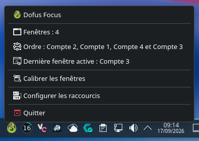

It lets you:

- calibrate multiple Dofus windows in a custom order, from any Dofus window or directly from the desktop;
- switch from one calibrated Dofus window to the next or previous one using global keyboard and mouse shortcuts;
- access the application actions from its tray icon menu;
- use a privileged input helper to handle keyboard and mouse shortcuts;
- integrate with KWin to manage and activate Dofus windows.

The application is designed for KDE Plasma on Wayland and currently supports Arch Linux and Arch-based distributions.
The application interface is available only in French.

## Table of contents <!-- omit in toc -->

- [Features](#features)
- [Requirements](#requirements)
  - [Required](#required)
  - [Dependencies](#dependencies)
- [Installation](#installation)
  - [Reinstallation](#reinstallation)
- [Uninstallation](#uninstallation)
- [Tray / Menu](#tray--menu)
- [Calibration](#calibration)
  - [Starting calibration](#starting-calibration)
  - [Calibrating Dofus windows](#calibrating-dofus-windows)
  - [Closing a Dofus window during calibration](#closing-a-dofus-window-during-calibration)
  - [Replacing a calibration](#replacing-a-calibration)
  - [Newly detected Dofus windows](#newly-detected-dofus-windows)
- [Shortcuts](#shortcuts)
  - [Shortcut configuration](#shortcut-configuration)
  - [Capturing a shortcut](#capturing-a-shortcut)
  - [Shortcut validation](#shortcut-validation)
- [Navigation](#navigation)
  - [Next / Previous](#next--previous)
- [Notifications](#notifications)
- [Input Devices](#input-devices)
  - [Hotplug support](#hotplug-support)
  - [Mouse interception](#mouse-interception)
- [Privileged Input Helper](#privileged-input-helper)
  - [Separation of responsibilities](#separation-of-responsibilities)
  - [Restricted IPC](#restricted-ipc)
  - [Input policy](#input-policy)
- [Architecture](#architecture)
- [Project structure](#project-structure)
- [Development / testing](#development--testing)
- [License](#license)

## Features

- **Dofus window calibration**: calibrate multiple Dofus windows and define the order used for navigation;
- **Next / Previous navigation**: switch between calibrated Dofus windows using global shortcuts;
- **Global keyboard shortcuts**: configure shortcuts for navigation and calibration;
- **Configurable mouse buttons**: use supported mouse buttons as global shortcuts for navigation;
- **KWin integration**: detect, track and activate Dofus windows;
- **KDE tray integration**: access the application and its current state from the system tray;
- **Session autostart**: optionally start Dofus Focus Tray automatically with the session;
- **Persistent shortcut configuration**: keep configured shortcuts across application restarts;
- **Keyboard and mouse hotplug**: automatically handle input devices being connected or disconnected;
- **Privileged input helper**: isolate `/dev/input` access in a dedicated privileged process;
- **Secure helper communication**: use authenticated and validated IPC between the application and the privileged helper.

## Requirements

### Required

- Arch Linux or an Arch-based distribution;
- KDE Plasma 6 or newer;
- a Wayland session;
- systemd;
- `pacman`;
- `sudo`;
- `vercmp`;
- the following KDE tools:
  - `kpackagetool6`;
  - `qdbus6`;
  - `kwriteconfig6`;
  - `kreadconfig6`.

### Dependencies

The installer automatically installs missing dependencies and installs newer package versions when the installed version does not meet the required minimum.

The following packages are managed automatically:

- `python` >= 3.11;
- `pyside6` >= 6.6;
- `kstatusnotifieritem` >= 6.0;
- `python-dbus-next` >= 0.2.3;
- `python-evdev` >= 2.0.0;
- `python-pyudev` >= 0.24.4;
- `libxkbcommon` >= 0.4.0;
- `kpackage` >= 6.0;
- `kconfig` >= 6.0;
- `qt6-tools` >= 6.0.

## Installation

Clone the repository and run the installer from the project directory:

```bash
git clone https://github.com/IlanRossigneul/dofus-focus-tray.git
cd dofus-focus-tray
./install.sh
```

The installer checks the system requirements, installs missing dependencies, updates dependencies that do not meet the required minimum versions, installs the application, configures the privileged input helper, and installs the KWin integration.

During installation, you can choose whether Dofus Focus Tray should start automatically with your session.

The application is installed under `~/.local/share/dofus-focus-tray`.

The installer also adds the following commands to `~/.local/bin`:

- `dofus-focus-tray` — launches the application;
- `dofus-focus-tray-uninstall` — removes the application.

Dofus Focus Tray is also available from the KDE application launcher under the **Utilities** and **Games** categories.

The installer does not require a logout or reboot after a fresh installation.

### Reinstallation

When reinstalling Dofus Focus Tray, the existing shortcut configuration is preserved.

If the KWin script was already loaded during the current session, the running KWin process may keep the previous QML code. After reinstalling, log out and log back in to ensure that the new KWin script version is loaded.

The installer does not log out automatically.

## Uninstallation

If Dofus Focus Tray is installed, the recommended way to uninstall it is:

```bash
dofus-focus-tray-uninstall
```

If you still have the cloned repository, you can also run the uninstaller directly from the project directory:

```bash
./uninstall.sh
```

The uninstaller:

- stops Dofus Focus Tray;
- removes the privileged input helper and its systemd integration;
- removes the KWin integration;
- removes the application runtime;
- removes the application and uninstaller wrappers;
- removes the KDE application launcher entry;
- removes session autostart.

The uninstaller does not remove the dependencies installed for Dofus Focus Tray automatically.

At the end of the uninstallation, the uninstaller displays the optional `pacman` commands that can be used to remove these dependencies manually.

## Tray / Menu

Dofus Focus Tray runs in the system tray and provides access to the application's current state, calibration and shortcut configuration.

Before a calibration is completed, the tray menu provides access to the detected Dofus windows, window calibration and shortcut configuration.

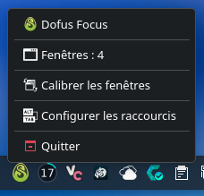

After a calibration is completed, the menu also shows the calibrated order and the last active Dofus window.


The menu items are displayed in the following order:

- **Detected Dofus windows** — shows the Dofus windows currently detected by the application;
- **Calibrated order** — shows the current navigation order after calibration;
- **Last active window** — shows the last active calibrated Dofus window;
- **Window calibration** — starts a new calibration without shortcut;
- **Shortcut configuration** — opens the shortcut configuration window.

Dofus Focus Tray can also use a discreet tray indicator when no Dofus window is detected. The tray remains available through the Status and Notifications popup.

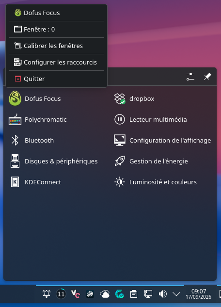

## Calibration

Dofus Focus Tray uses a calibration process to define the order in which Dofus windows are navigated.

### Starting calibration

Calibration can be started from an active Dofus window or directly from the desktop.

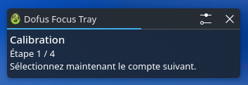 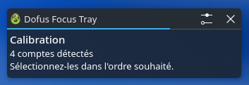

Starting a new calibration immediately resets the current calibration, whether it was completed or still in progress.

### Calibrating Dofus windows

Select each Dofus window in the order you want to use for navigation, for example from the account with the highest initiative to the account with the lowest.

Each selected window is added to the calibration. A Dofus window can only be selected once.

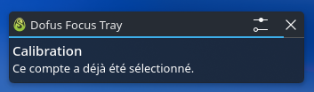

When all Dofus windows have been selected, the calibration is completed and the selected order becomes the navigation order used by the **Next** and **Previous** shortcuts.

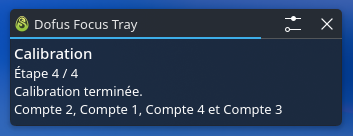

### Closing a Dofus window during calibration

Closing a Dofus window during calibration does not always have the same effect.

If a **calibrated Dofus window** is closed before the calibration is completed, the calibration is cancelled.

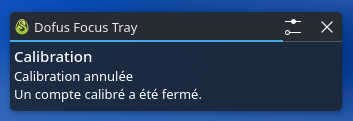

If an **uncalibrated Dofus window** is closed, the calibration continues. If no other Dofus windows remain to be calibrated, the calibration is completed with the remaining calibrated windows.

Once all calibrated Dofus windows have been closed, the current calibration ends and is reset.

### Replacing a calibration

A calibration in progress or an already completed calibration can be replaced at any time by starting a new calibration.

The new calibration resets the previous calibration and defines a new navigation order.

### Newly detected Dofus windows

Once a calibration has been completed, a newly detected Dofus window is not automatically added to the navigation cycle.

The application notifies you when a new Dofus window is detected and invites you to start a new calibration if you want to include it.

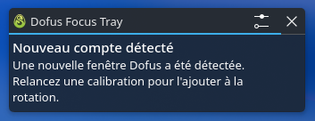

## Shortcuts

Dofus Focus Tray supports global keyboard shortcuts and configurable mouse buttons.

### Shortcut configuration

Open **Shortcut Configuration** from the tray menu to view and configure the available shortcuts.

By default, no shortcuts are configured. Each action can have a primary shortcut and an alternate shortcut.

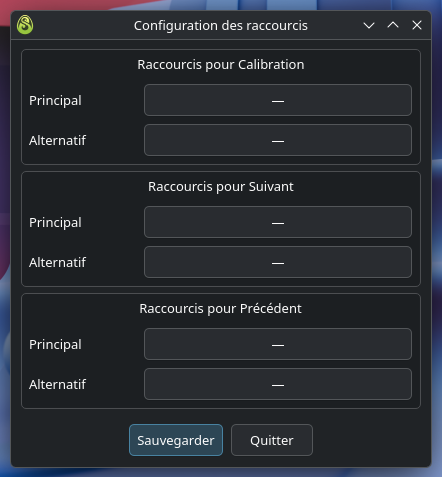

The available actions are:

- **Calibration**;
- **Next calibrated Dofus window**;
- **Previous calibrated Dofus window**.

### Capturing a shortcut

Click a shortcut field to start capturing an input.

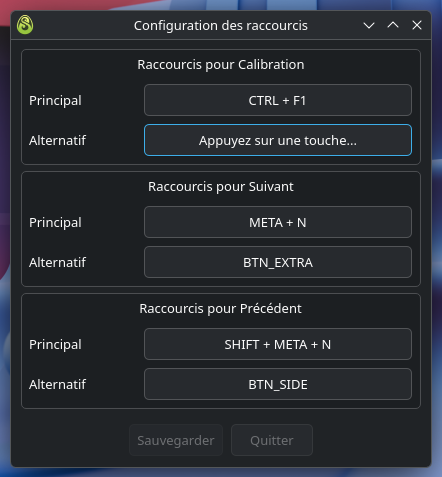

During capture:

- press **Escape** to cancel the capture;
- press **Backspace** during a capture to clear the current shortcut;
- keyboard shortcuts can contain one or more modifiers and exactly one non-modifier key;
- left, middle and right mouse buttons, as well as the mouse wheel, cannot be used as shortcuts;
- supported additional mouse buttons can be configured only for **Next** and **Previous**.

### Shortcut validation

Dofus Focus Tray prevents invalid or conflicting shortcuts.

A shortcut already assigned to another action cannot be assigned again.

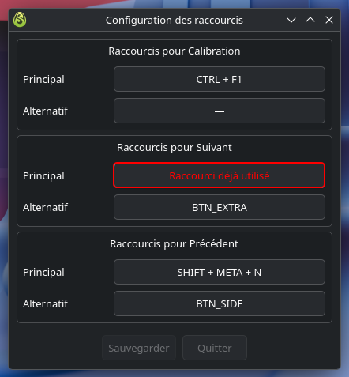

Mouse buttons cannot be assigned to the **Calibration** action.

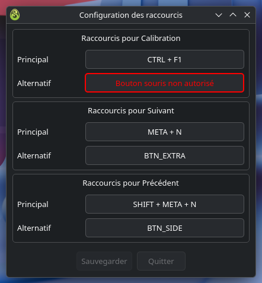

Configured shortcuts are saved when you choose to save the configuration and remain available after restarting the application.

## Navigation

Once a calibration has been completed, Dofus Focus Tray can switch between the calibrated Dofus windows using the **Next** and **Previous** actions.

### Next / Previous

**Next** activates the next Dofus window in the calibrated order.

**Previous** activates the previous Dofus window in the calibrated order.

Navigation always follows the order defined during calibration. The KDE taskbar order is not used for navigation.

When navigation reaches the last calibrated Dofus window, **Next** continues from the first one. When it reaches the first calibrated Dofus window, **Previous** continues from the last one.

If a calibrated Dofus window is closed after the calibration is completed, the remaining calibrated Dofus windows continue to be cycled normally.

## Notifications

Notifications from Dofus Focus Tray are grouped together in the **Notification Center**, where you can review previous notifications from the application.

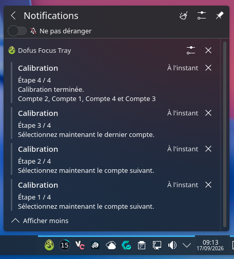

To display Dofus Focus Tray notifications even when Dofus windows are in fullscreen mode, right-click **Notifications** in the system tray and select **Configure Notifications**, or select **Configure Notifications** from the Notification Center. Then select **Configure for applications**, choose **Dofus Focus Tray**, enable **Show in "Do Not Disturb" mode**, and apply the changes.

## Input Devices

Dofus Focus Tray automatically detects and handles keyboard and mouse devices connected to the system.

### Hotplug support

Input devices can be connected or disconnected while Dofus Focus Tray is running.

The application automatically detects these changes and updates the devices used for global shortcuts. You can therefore change your keyboard or mouse without restarting Dofus Focus Tray.

### Mouse interception

When a valid calibration is completed, Dofus Focus Tray grabs the physical mouse device to intercept the supported mouse buttons used by the application.

This grab is handled transparently and does not require any action from the user.

The mouse grab is released as soon as the calibration is cancelled, either because all calibrated Dofus windows have been closed or because a new calibration is started.

This allows mouse shortcuts to be handled globally without letting the intercepted buttons trigger their normal actions at the same time.

## Privileged Input Helper

Dofus Focus Tray uses a dedicated privileged helper to handle low-level keyboard and mouse input.

The helper runs separately from the main application because reading physical input devices requires access to `/dev/input`. Granting these privileges directly to the tray application would give the entire application access to the system input devices.

Instead, Dofus Focus Tray follows a least-privilege approach: only the dedicated helper runs with the privileges required to access `/dev/input`, while the main application runs as the regular user.

### Separation of responsibilities

The helper is responsible for:

- discovering keyboard and mouse input devices;
- handling input device hotplug events;
- reading the physical input events required for global shortcuts;
- applying the input policy defined by Dofus Focus Tray;
- grabbing and releasing the physical mouse when mouse interception is required.

The main application does not directly access `/dev/input`.

### Restricted IPC

The main application communicates with the helper through a local Unix socket.

The helper accepts a single client connection from the Dofus Focus Tray application. The connection is authenticated using the client's Unix credentials and messages are strictly validated before they are processed.

The helper does not expose the raw keyboard input stream to the application. During shortcut capture, it only forwards keyboard events that match the helper's input policy.

Mouse events are filtered by the same policy. Mouse movement, the left, middle and right mouse buttons, and mouse wheel events cannot be used as shortcuts.

This keeps the privileged part of the application isolated from the rest of the application and limits the amount of raw input that can cross the IPC boundary.

### Input policy

The input policy is enforced inside the privileged helper.

It is therefore not possible for an external client connected to the socket to change the rules used to filter input events. The helper validates commands and applies its own policy before sending any supported event to the application.

This design reduces the privileges of the main application and limits the privileged component to the input operations it actually needs.

## Architecture

Dofus Focus Tray is split into a regular user application and a dedicated privileged input helper.

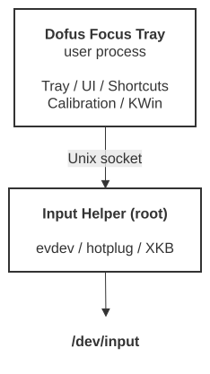

The main application runs as the regular user and does not access `/dev/input` directly.

The privileged helper handles low-level keyboard and mouse input and communicates with the main application through a local Unix socket.

The helper uses systemd socket activation and is started when the application connects to its socket.

## Project structure

The repository is organized into the application source code, development tools and tests.


## Development / testing

The repository includes development tools and tests for the project.

Use `./dev.sh` to reload the KWin integration during development.

Run the test suite with:

```bash
pytest
```

Check the code with:

```bash
ruff check .
ruff format --check .
vulture .
```

The reported `vulture` warnings have been reviewed and are known false positives.

## License

Dofus Focus Tray is licensed under the GNU General Public License v3.0.
